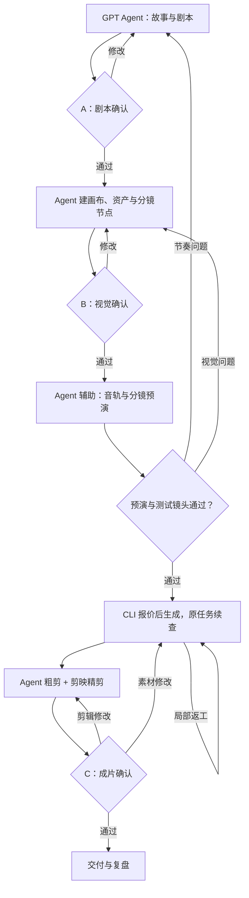

# AI 漫剧创作工作流 v0.7：GPT Agent + 即梦画布 CLI + 抖音/红果交付

更新：2026-10-13。依据：既有平台资料与用户上传的《即梦画布 CLI 使用说明》，本次新增用户粘贴的个人版权方操作手册 [S16]、通过浏览器逐章读取的《动画微短剧（漫剧）内容创作建议》在线正文 [S17]，以及身份指南截图 [S18]。操作手册中的图片未随正文提供；合同全文与版权专区选本尚未实测；本轮已安装CLI并检查实际账号权限。

**当前设计将“内部样片验证”与“正式上架”分开：先完成一集和前三集验证；漫剧首次上传包及整剧均至少20分钟。个人版权人可按实际业务多选真人剧、漫剧。** v0.7已实现不依赖会员的本地分镜导出、素材导入、临时旁白、静态预演、多镜头粗剪、字幕与内部交付检查；24项测试通过。即梦保存/报价/生成及原任务恢复代码保留，真实成功路径仍待会员权限。详见[任务清单](docs/development-tasks.md)、[执行规格](docs/workflow-execution-spec.md)和[使用说明](README.md)。

本版延续已按上传说明修正的接入设计：**GPT‑6.1 Agent 负责创作与调度，使用 `dreamina-canvas` 直接创建和编辑即梦协同画布；你在网页端查看、挑选和调整结果。** 主流程是故事与资产 → 画布节点搭建 → 报价与授权 → 分阶段生成 → 原任务查询与产物验证 → 画布预演或本地粗剪 → 剪映精剪与交付。GPT 图像工具仍可制作参考和关键帧，再由 CLI 上传入画布。

关键区别：`dreamina-canvas` 是本设计使用的画布 CLI；此前引用的 `dreamina` 是旧 Dreamina CLI。用户上传的页面截图提示旧 CLI 将于 11 月起停止维护并要求迁移 [S15]，因此本工作流不得自动回退到旧工具。正确命令末尾为 `canvas`（有 s），不是 `dreamina-canva`。旧命令和旧 Skill 路径不适用于本流程。安装、账号、版本和权限仍需实际验证。

当前已有真实GPT咖啡首帧及包含中文临时旁白的6秒本地静态预演，尚无即梦AI动态视频或投稿结果。dreamina-canvas 1.0.2及配套Skill已安装到项目.tools；FFmpeg/ffprobe已安装，macOS say临时语音实测可用。此前用户已完成CLI授权，但画布操作返回vip_membership_required；按用户决定先完成本地功能。认证与签约状态仍待回传。文中60–90秒、镜头数、布局和预算为制作建议，第11节上传门槛来自用户提供的平台手册。制作、发布和付费授权分别按实际用户指令处理。

## 1. 平台调研与设计取舍

“公开能力”来自来源索引；“借鉴内容”为我们的设计判断。

| 平台 | 已公开的能力或工作流 | 我们借鉴什么 | 当前用途 |
|---|---|---|---|
| [即梦画布](https://jimeng.jianying.com/ai-tool/home/?createTab=canvas&need_login=true) | 新画布支持想法/剧本/参考输入、Agent 技能和主体引用；官网另有多图层智能画布编辑介绍 [S1][S2] | 在视觉工作区集中比较参考、候选和镜头 | **主要平台** |
| [抖音集团短剧创作者中心](https://www.shortdramas.com/) | 个人版权人可多选真人剧/漫剧，完成认证、签约、上传、经营与结算 [S16][S18]；漫剧内容建议已在线读取 [S17] | 将渠道要求放进选题、制作和交付验收 | **拟合作与发布渠道，账号流程待完成** |
| 即梦画布 CLI `dreamina-canvas` | 上传说明明确覆盖画布创建、素材上传、媒体/文本/主体/时间轴节点、报价、生成、查询与下载 [S14] | Agent 直接搭建和执行，人通过同一网页画布审阅 | **主要执行接口；schema/登录已测，生成待会员权限** |
| [阅文 DramaBuddy 漫剧助手](https://dramabuddy.yuewen.com/) | 小说、剧本、分镜三种起点；资产提取、多模态制作、全剧共享资产、无限画布与合作入口 [S3] | 先提取角色多状态，再制作镜头；全剧和单集分别管理 | 流程与合作线索参考 |
| [腾讯 WorkRally](https://workrally.qq.com/) | 官方 CLI／Skill 文档覆盖项目、剧集、场次、资产、画布与生成结果 [S5][S6][S7] | 稳定 ID、素材绑定、图/视频/音频独立记录 | 生产管理与自动化参考 |
| [腾讯云媒资 AIGC](https://cloud.tencent.com/document/product/1156/64096) | 生成、智能成片、字幕、音视频处理与创作 SaaS，也集成阅文助手 [S4] | 后期、媒资与质量检查作为独立阶段 | 批量处理备选 |
| [可灵 AI](https://klingai.kuaishou.com/) | 官方披露多模态创作、一致性、多镜头叙事和原生音频 [S9] | 难镜头采用多参考与短段落验证 | 候选备选，暂不接入 |
| [蝉镜无限画布](https://doc.chanjing.cc/help-center/infinite-canvas/quick-start.html) | 节点、素材连线、生成、检查、局部修改的公开教程 [S10] | 输入与依赖可见，修改后处理相关部分 | 画布模板参考 |
| [LocalMiniDrama](https://github.com/xuanyustudio/LocalMiniDrama) | 维护者定位为故事到分镜、视频的本地创作工具 [S11] | 本地素材与工作流组织 | 工程参考，暂不部署 |

当前以即梦画布和剪映作为主要平台，GPT Agent 同时承担创作、可用工具内的素材生产、检查和执行。图片可以由 GPT 生图工具或即梦制作，不要求所有图片来自同一平台；跨工具使用前先验证角色、画风延续、费用、导出和使用条件。

### 1.1 “腾讯短剧”需要拆开理解

- 制作工具：本次找到腾讯 WorkRally 官方项目，适合参考全流程管理。
- 云服务：腾讯云媒资 AIGC 是另一套生成、后期与媒资产品。
- 发行合作：腾讯视频等渠道的合作条件，需要独立核实。

WorkRally 官网本次未能通过公开网页抓取读取，其能力依据是腾讯官方 GitHub 文档。这不能证明你的账号已经开通，也不能确认当前价格和发行政策。社区文章、工具导航的提效数字或“一键发行”描述不作为设计依据。

### 1.2 即梦能力边界

| 能力 | 公开确认 | 仍需账号实测 |
|---|---|---|
| 图片智能画布 | 官网介绍局部重绘、扩图、消除、抠图、多图层 [S1] | 当前新画布中各操作的位置、权限与限制 |
| 新画布 / Agent | 官方页面显示新建画布、技能、剧本/参考输入与主体引用 [S2] | 分镜输出结构、批量规模、项目共享、导出及视频编辑范围 |
| 即梦画布 CLI | 上传说明明确支持协同画布创建/编辑、节点引用、生成与查询；返回画布地址 [S14] | 实际账号权限、版本、结构化输出、并发限制；审核状态回写方式 |
| 声音 | 画布 CLI 支持 TTS 和音乐；主体节点有声音引用参数 [S14] | 实际音色、音乐模型、字幕/口型方案与音效能力 |
| 时间轴 | 支持时间轴节点及视频/音频片段参数 [S14] | 精确片段结构、裁剪/转场/字幕、整片渲染与导出；不能据此承诺完整精剪 |

CLI 直接操作服务端协同画布已经由上传说明确认，不能继续描述为仅在本地生成文件后手动上传的工具。网页审阅与 CLI 操作共享画布，但已批准镜头、候选选用和审核意见的结构化回写仍需 schema/实测核实。图片编辑画布、Agent 创作和精剪仍是不同能力，不因存在时间轴节点就假定支持完整多轨成片导出。

### 1.3 两套 CLI 对照与防混用规则

| 项目 | 旧 Dreamina CLI | 即梦画布 CLI（本工作流使用） |
|---|---|---|
| 命令入口 | `dreamina` | **`dreamina-canvas`** |
| 文档描述的工作对象 | 图/视频生成任务、历史、会话与下载 [S8] | 服务端协同画布、节点、引用、资源与生成操作 [S14] |
| macOS/Linux 安装入口 | `https://jimeng.jianying.com/cli`（历史对照，勿用于本流程） | `https://jimeng.jianying.com/canvas-cli/install.sh` |
| Skill 入口 | `~/.dreamina_cli/dreamina/SKILL.md`（历史对照） | `~/.agents/skills/dreamina-canvas-cli/SKILL.md` |
| 登录/账号检查 | `dreamina login` / `dreamina user_credit` | `dreamina-canvas auth login` / `auth account` |
| 生成入口示例 | `text2image` / `image2video` 等旧命令 | `node create/edit` 保存设置，`node quote/run` 或 `--run` 进入报价/生成 |
| 查询/下载 | `query_result --submit_id=... --download_dir=...` | `operation status/wait`、`resource get/download` |
| 记录对象 | 旧版任务记录，不套用于新版 | projectId、nodeId、submitId、resourceId |
| 本项目选择 | **禁止作为画布执行回退** | **唯一允许的即梦 CLI 入口** |

截图显示旧 CLI “将于 11 月起停止维护”，但没有注明年份，不据此推断确切停维护日期或旧服务何时不可用；截图还显示“内测期间仅限会员使用”，实际当前账号权限仍通过 `auth account` 与平台错误核实。

执行前检查：

1. 使用 `command -v dreamina-canvas` 定位正确程序，再读取它的 `version`、`--help`、`schema` 与配套 Skill。
2. 画布操作的命令入口只能为 `dreamina-canvas`。即使本机同时装有 `dreamina`，也不以名称相近为由替换。
3. 新 CLI 缺失、失败、权限不足或参数不兼容时，记录原因，检查新 CLI 或转人工画布步骤；不自动安装/调用旧 CLI。
4. 不混用两套安装地址、Skill、登录命令、参数、任务 ID 和本地恢复文件；新版真实返回值不能按旧字段格式猜测解析。
5. 批量执行前复核每条即梦命令的入口；审核点和预算控制不因迁移而绕过。

执行脚本仅定位并调用dreamina-canvas，不提供旧工具回退；这不等于系统级命令拦截器，也不限制用户自行运行其他命令。

## 2. 首轮制作目标与工具分工

### 2.1 两种成片形式

| 形式 | 表现方式 | 首轮取舍 |
|---|---|---|
| 解说型动态漫 | 旁白、静帧运镜、少量动态素材 | 可验证故事、素材与成本；正式合作前需确认平台体裁认定 |
| 剧情型 AI 漫剧 | 人物对白、动作、情绪表演、连续镜头 | 更依赖口型、声线和空间连续性，先缩小规模 |

首轮样片默认提案为漫画/插画风、旁白或少对白形式；剧本审核时决定。[S17] 未明确禁止旁白配静帧运镜，也未承诺这种形式一定可作为漫剧合作。以连续剧情和人物行动组织样片，在扩大制作前通过账号规则或平台反馈确认体裁；不把图文朗读、段子合集或拼接内容自动认定为合格漫剧。不能在生产中未经记录就切换表现形式。

建议先做 1 集，再扩展到前三集：每集 60–90 秒，目标约 75 秒；2 名主要角色、1–2 个场景；初步 10–15 个镜头，依叙事和音轨调整。默认 9:16，交付目标 1080×1920、30fps，正式合作前按渠道要求修改。

制作规模分为三阶段：

| 阶段 | 规模与目的 | 是否满足漫剧首次上传时长 |
|---|---|---|
| 内部首集样片 | 1集约75秒；验证故事、参考、动态、声音与成本 | 否 |
| 前三集验证 | 约3分45秒；检查资产复用、连续性和返工 | 否 |
| 正式首发包 | 实际成片总时长至少1200秒；建议规划18集×75秒，约22分30秒，留剪辑余量 | 导出后逐集探测并累计，不能仅按计划集数判定 |

18集是制作建议，不是平台规定集数，也不代表已授权批量生成。固定每集75秒时16集刚好20分钟；缩短后可能不足。全剧集数与完结计划在剧本审核时确定，首发包可以连载，但必须有可执行的后续安排；不重复片段、拉长空镜或拼接其他剧来凑时长。真人短剧按自身上传规则执行，不套用这份手册仅列给漫剧的20分钟门槛 [S16]。

### 2.2 分工

| 工具或角色 | 责任 | 产物 |
|---|---|---|
| GPT‑6.1 Agent / Codex | 故事与剧本、视觉方案、调用生图/编辑工具、分镜设计、素材对照检查、返工判断；具备执行环境时运行媒体处理与合成脚本；跟踪版本、成本和任务 | 制作包、角色/场景/关键帧图片、检查意见、预演/粗剪、任务与成本记录 |
| GPT 图像生成工具 | 依据 Agent 指令生成或编辑概念图、参考图、关键帧、封面等 | 图片候选与选用版本，记录来源与生成参数 |
| 即梦协同画布 | 保存主体/参考、图/视频/音频/时间轴节点及生成结果，供网页审阅 | 服务端画布、真实节点与素材 |
| 创作者 | 方向、剧本、视觉、预演、测试与成片审定；画布操作和回传 | 选择记录、反馈和定稿版本 |
| 剪映 | 时间线、节奏、对白/旁白、音乐音效、字幕、导出 | 剪辑工程与成片 |
| FFmpeg / ffprobe | 可选：探测、抽帧、代理文件、标准化和批量导出 | 媒体信息与检查结果 |
| `dreamina-canvas` | Agent 的主要画布执行接口：模型发现、画布与节点搭建、素材上传、报价、生成、查询、下载 | projectId / nodeId / submitId / resourceId、webUrl、报价与实际消耗 |

在支持生图工具的对话环境中，可以直接生成、修改图片；访问本地文件和终端需要相应执行环境。操作即梦画布或剪映，需要实际工具接入或人工协作。首轮不需要开发网站、队列服务或多用户后台。

### 2.3 模型、工具和 Agent 的能力边界

GPT‑6.1 支持图片理解，并可通过工具执行工作；“GPT Agent 生图”指 Agent 调用接入的图像生成/编辑工具，不是把 GPT‑6.1 本身当作图像输出模型。官方模型页面将图片列为输入，音视频不属于其原生输入输出；图像工具另使用 GPT Image 模型 [S12][S13]。

| 工作 | Agent 的作用 | 执行条件 |
|---|---|---|
| 图片生成/编辑 | 将故事、角色与镜头约束转成图像任务，生成候选并迭代 | 环境已提供图像生成/编辑工具 |
| 图片检查 | 对照角色、场景与前后镜头，指出外貌、道具、构图问题 | 实际图片可见；判断为辅助，不保证发现所有缺陷 |
| 视频检查 | 调用工具抽帧、探测时长与格式，检查可见画面 | 原视频可访问，媒体工具可用；动态与口型仍需播放验收 |
| 配音、音乐与音频检查 | 通过画布 CLI 的 TTS/音乐节点生成，按需要另接音效或转录工具 | 登录、音色/模型、权限与预算可用；GPT‑6.1 本身不原生听音或配音 |
| 预演/粗剪 | 编写并运行 FFmpeg / Remotion 等脚本，组织静帧、字幕与音轨 | 终端、依赖、素材、字体均可用，结果需播放检查 |
| 即梦任务 | 用 `dreamina-canvas` 创建/编辑节点、报价、运行、查询与下载 | CLI、当前 Skill、账号与参数验证通过；不可用时人工协作 |
| 剪映操作 | 提供时间线、入出点与修改清单；可接入时协助操作 | 不默认存在稳定 API 或可控的已登录桌面环境 |

启动时记录本次实际可用工具，不把“模型支持工具调用”误当成“所有外部平台已经接通”。权限和能力不足时切换到人工步骤；已取得的生成或修改授权在范围内继续有效。

### 2.4 图片在哪个平台生产

| 素材 | 默认安排 | 选用依据 |
|---|---|---|
| 角色概念、服装、画风方向 | 可先由 GPT 图像工具生成 | 比较创意、外貌与美术方向，选定后冻结版本 |
| 场景、道具参考 | GPT 图像工具或即梦 | 看一致性、编辑可控性、实际费用和输出质量 |
| 分镜关键帧 | 即梦为主；也可直接使用通过检查的 GPT 图片 | 能否在即梦中稳定生成对应角色和动作 |
| 局部修图 | 选用效果更好的已接入编辑工具 | 保持定稿外貌、服装、构图与必要细节 |
| 封面、海报 | GPT 图像工具或即梦 | 风格与成片匹配；精确文字后期排版 |

选定一个角色参考后，先把它导入即梦测试代表镜头。若跨工具延续不稳定，先修参考或在即梦内建立可复用主体，不把“图片已生成”当成“视频一致性已通过”。同一镜头的图片和视频来源分别记录。

## 3. 主工作流与验收



保留 A/B/C 三个主审核点。预演和测试是批量生产前的质量检查，不要求查询、下载、已经授权的小修反复确认。

| 阶段 | 动作与产物 | 完成标准 |
|---|---|---|
| 0 启动检查 | CLI/Agent 能力与画布权限；渠道身份、体裁、选本入口和规则版本；capabilities.json、requirements.md | 工具和渠道已知与未知分开；文本规划可先推进 |
| 1 故事规划 | 原创或IP来源、全剧主线、角色动机、逐集事件、悬念与结局、首发/完结计划；brief.md、series-outline.md | 因果明确、规模可实现，内容导向已检查；改编权状态明确 |
| 2 剧本与分镜 | 台词、场次、镜头用途、动作、声音、时长、内容问题定位；script.md、shots.json/csv | A：内容、体裁方案与规格通过 |
| 3 资产定稿 | Agent 上传 GPT 参考、建画布和主体/图片节点；报价后生成或编辑；保存全部引用；asset-bible.md、assets/ | B：视觉确定；已选资源与参考版本锁定 |
| 4 分镜预演 | CLI 查询音色并生成 TTS，使用已选静帧与音轨；时间轴能力验证后搭建，否则 Agent 本地合成/剪映；animatic.mp4 | 故事与节奏成立，声音与时长已检查 |
| 5 代表镜头测试 | 有人物脸、场景与代表动作的镜头；test-shot.mp4、实际成本 | 参考、动作、声音方案可接受 |
| 6 动态生产 | CLI 小批报价/运行 `m2v` 等视频节点；原任务续查、节点/资源终态验证、下载和检查；shots/、generation-log.jsonl | 每批过审，未完成产物不能入片 |
| 7 后期精剪 | Agent 可执行粗剪、字幕与格式处理；剪映完成创作者精调；剪辑工程、rough-cut.mp4 | 全片完整可播、音画同步 |
| 8 成片审核 | 叙事、连续性、全剧/单集质量、剧名简介封面与规格；final-review.md | C：没有阻塞问题；样片通过与首发包就绪分开记录 |
| 9 交付复盘 | 样片或首发包、探测清单、版本、成本与渠道资料；delivery/、retrospective.md | 文件可用；正式包另通过第11节检查，发布仍需授权 |

## 4. 即梦画布的组织与协作

### 4.1 推荐画布布局

以下为逻辑摆放规则。上传说明确认文本、图片、视频、音频、主体和时间轴节点，并支持节点引用保留上下游关系；精确布局/分组和其他节点类型以当前 schema 为准，不能猜测坐标或分组参数。

| 区域 | 内容 | 规则 |
|---|---|---|
| 00 制作说明 | 画风、比例、剧本版本、固定设定 | 不混入未批准的新风格 |
| 01 角色主体 | 定稿角色、服装、状态与表情参考 | 角色 ID + 版本 |
| 02 场景道具 | 全景、布局、关键道具 | 门窗、光线、持有者明确 |
| 03 分镜候选 | 按镜头号摆放静帧候选 | 定稿与候选明确区分 |
| 04 动态候选 | 视频和修订版本 | 旧版本保留，标记选用 |
| 05 已选镜头 | 本集采用的图/视频 | 下载并登记文件 |
| 06 问题返工 | 问题、定位、修改要求 | 说明要改什么、保持什么 |

平台允许时使用全剧资产画布加每集生产画布；不支持跨画布引用时，复制/上传已定稿参考并登记来源。不要假定跨画布素材会自动更新。

### 4.2 稳定 ID

- 角色 `CHAR-001`；场景 `LOC-001`；道具 `PROP-001`。
- 镜头 `E01-SC01-SH003`：集、场景、镜头。
- 文件 `E01-SC01-SH003_keyframe_v02.png`、`E01-SC01-SH003_video_v03.mp4`。
- 同一镜头可以有多个候选，选用关系单独记录，避免覆盖旧文件。
- 平台四类 ID 与镜头 ID 分开保存，使用 CLI 实际返回值。人工路径拿不到 ID 时记录画布地址、可见标题、时间和文件；不得编造 ID。

只有网页链接、没有媒体文件时，不能标记为“已导入剪辑”。画布用于创作，本地清单用于记录定稿、版本、路径、审核和成本。

### 4.3 双向协作闭环

1. GPT Agent 输出剧本、资产说明和镜头表，通过可用生图工具制作参考，或规划画布图片节点。
2. CLI 创建画布，保存 projectId/webUrl；上传参考得 resourceId，把素材放入节点并保存 nodeId。
3. 先保存节点和完整参数，不加 `--run`；检查引用与模型，报价，在既有授权范围内执行。
4. 使用真实 submitId 查询原任务，确认节点与 resourceId 产物完成后下载；提供 webUrl 供你查看挑选。
5. Agent 记录选用和检查结论；修改生成设置时提交完整参数和全部引用，避免丢失角色参考。
6. 生成 TTS/音乐并组织预演；验证时间轴能力后搭建画布预演，或本地粗剪；剪映完成精调。

主要路径为 CLI 直接操作同一服务端画布；网页用于查看、选用与调整。CLI 暂不可用时采用制作包人工执行。不使用旧 `dreamina` 命令替代画布接口，不使用猜测的隐藏接口。

### 4.4 四类 ID、引用与定稿冻结

| CLI 字段 | 对象 | 本地映射 |
|---|---|---|
| projectId | 一块画布 | canvas_project_id；每次操作核对项目 |
| nodeId | 画布节点 | image/video/audio/element/timeline_node_id，分别保存 |
| submitId | 一次运行与恢复查询 | CLI 运行记录，按操作保存 |
| resourceId | 具体素材产物 | 候选、已选与参考资源 ID |

`--ref "node:<nodeId>"` 引用节点的最新产物并保留上下游关系，搭建时优先使用。`--ref "res:<resourceId>"` 指向一份确定素材。定稿后记录具体选用 resourceId；需要防止参考随上游变化时，使用固定资源引用或复制冻结节点，支持方式先看 schema。

节点引用不是永久锁定版本。上游重新生成后复查下游引用和候选选用，不自动认为旧镜头仍然有效。`canvas ls` 只查看，不切换当前画布；多项目执行不要依赖上次终端的当前上下文，按命令支持范围显式携带 projectId 或使用 schema 已确认的选择操作。

## 5. 全剧资产与连续性

| 类型 | 必填设定 |
|---|---|
| 角色 | 身份、年龄设定、面部特征、体态、发型、服装、颜色、饰品、说话方式 |
| 角色状态 | 常服/雨衣/受伤等差异；状态出现和结束镜头 |
| 场景 | 时间、天气、门窗、陈设、光线方向、人物进出与站位 |
| 道具 | 外观、尺寸、重要性、出现镜头、持有者、状态变化 |
| 声音 | 声线来源、角色对应、语速、情绪、使用条件 |

三视图、表情图用于角色设定；生成单镜头视频时优先使用独立关键帧，不把含多个画面的九宫格直接当首帧。

每镜头记录上一镜结束与下一镜开始的关系：角色在哪边、面对哪里、手持什么、动作如何承接。正反打检查视线和屏幕方向。全剧另保存人物知识、关系、服装、物品和伏笔变化表；下一集以定稿内容和状态表为准。

| 修改 | 需要复查的下游 |
|---|---|
| 角色外貌或服装 | 引用对应状态的图与视频 |
| 场景布局 | 同场景空间、光线、站位与正反打 |
| 台词 | 配音、口型、时长、字幕与时间线 |
| 镜头顺序 | 动作、情绪、音轨、字幕时间码 |
| 音色 | 该角色本集和后续集音轨 |
| 导出规格 | 裁切、安全区、字幕和输出 |

受影响项标记为 `stale` 后复查，确认无影响的素材继续使用，不因一处修改自动重做整集。

## 6. 分镜设计与静态预演

先拆故事节拍，再拆可制作镜头。首集可采用“异常/问题 → 人物目标 → 阻碍 → 新信息 → 局部结果与悬念”；具体秒数由故事与音轨决定。

每镜头至少包含以下字段：

| 字段 | 内容或例子 |
|---|---|
| shot_id / narrative_goal | 镜头 ID / 发现委托信没有署名 |
| characters / location / props | 角色、场景、道具 ID 与版本 |
| framing / action / camera | 手部特写 / 翻开信纸 / 固定机位 |
| image_prompt | 主体、构图、环境、光线、画风 |
| video_prompt | 主要动作、节奏、运镜与结束状态 |
| audio / subtitle | 台词、旁白、环境声、字幕文本 |
| continuity_in / out | 上一镜递信完成 / 信纸摊在桌上 |
| edit_duration / generation_duration | 剪辑目标秒数 / 实际生成档位 |
| render_mode / acceptance | 表现方式 / 该镜头的验收要点 |

剪辑目标时长不必等于生成时长。适当生成余量便于选切点，但额外时长也要计入成本。

### 6.1 混合镜头策略

| 方式 | 适用镜头 | 制作方法 |
|---|---|---|
| 静帧运镜 | 回忆、说明、道具、过场 | GPT 图像工具或即梦生图，Agent 脚本或剪映制作轻微推拉/位移 |
| 轻动态 | 眨眼、抬头、雨丝、风动 | 图生视频，控制动作数量 |
| 完整视频 | 关键动作、转折、表演 | 单独验证参考、动作与声音 |

把动态预算优先用于真正需要运动的剧情点。这是制作策略，不证明某种形式必然符合发行平台的品类要求。

### 6.2 预演步骤

1. Agent 有终端与媒体工具时按镜头表合成已选分镜图；否则按顺序导入剪映。
2. 加临时旁白/对白，测量语速和停顿。
3. 调整镜头长度，检查画面是否充分表达台词与动作。
4. 完整播放，检查故事理解、情绪和结尾悬念。
5. 更新剧本和镜头表，定稿预演，再进入动态生成。

解说型可用画布 TTS 固定正式旁白，再下载测量时长；对白型先用临时台词测试，确定口型/原生音画方案后锁音轨。TTS 音轨存在不等于视频已经口型同步。原生音画也要检查实际台词，不假定与文本完全一致。

画布可创建 `timeline` 节点，参数包括 `--clip` 和 `--audio-clip` [S14]。其片段对象、裁剪和导出接口未在上传说明中完整展开；先查询 schema 做一个短预演试验。未验证整片渲染/导出前，继续以 Agent 本地合成和剪映交付。

## 7. 给即梦画布的制作包与指令

每集由 GPT 输出：集简报、剧本、资产说明、镜头表、逐镜头提示词、回传/检查表。提供可复制 Markdown 与 JSON/CSV。参考素材分别标注角色、场景和画风用途。

同时交付在本阶段实际生成的参考或关键帧图片，登记来源、版本和状态；未调用生图工具时标记“待生成”，不能只提供提示词却声称素材已完成。

### 7.1 画布启动指令

```text
项目：{名称}；集号：E01；剧本版本：v01。
请依据已确认剧本与资产设定，协助制作本集分镜。
比例：9:16；风格：{已确认风格}。
角色、服装、场景和道具以所附定稿参考为准。
先整理资产与镜头清单，保留我提供的镜头编号。
不自行新增角色、换装、改结局或合并关键动作。
本次只准备资产与指定分镜图，视频生成另行安排。
若支持主体引用，请对应到指定角色；不支持的操作请说明。
```

这是创作指令。CLI 搭建时默认只保存节点，不加 `--run`；需要生成时先对保存节点报价并检查授权。预算上限参数从当前 schema 获取，不猜测标志名称。按最新报价和在途预算执行，不能把提示词里的“限制积分”当实际控制。

### 7.2 单镜头静帧

```text
镜头：E01-SC01-SH003；版本：v01。
用途：发现委托信没有署名。
参考：CHAR-001 常服 v01、LOC-001 修复店 v01、PROP-001 信纸 v01。
画面：手部特写，信纸摊在木桌中央，主角衣袖局部入画。
保持袖口、信纸颜色、桌面朝向与前镜一致。
风格：{定稿风格}；比例：9:16。
生成一张独立镜头图，不做九宫格，不生成字幕。
剧情中需要精确可读的文字由后期添加。
```

### 7.3 单镜头动态

```text
镜头：E01-SC01-SH003；输入：已选静帧 v02。
主要动作：主角轻轻展开信纸，随后停住。
固定机位，动作克制，不新增物体，不突然切换视角。
结束状态：信纸平放，手停在纸边，便于接下一镜。
保持人物服装、手的数量、桌面和信纸一致。
声音方案：后期旁白；如生成环境声，仅需轻微纸张声。
时长：当前模型支持的档位，提交前核对积分。
```

避免一个镜头同时要求站起、出门、奔跑、回头和换场景；拆分后更容易定位失败。

### 7.4 问题回传

```text
镜头 ID：
当前版本/候选：
问题时间段：
问题：
必须修改：
必须保持：
期望处理：修图/重生成视频/换静帧方案/剪辑处理
素材文件：
本次积分和人工用时：不清楚时填 unknown
```

先判断问题所在层：手部错误优先修关键帧，台词过长先处理音轨和时长，字幕问题在剪辑里处理。

### 7.5 Agent 执行一次镜头任务的闭环

以“女主推门进入旧书店”为例：Agent 拆成进入全景、人物近景与反应镜头；确认角色/场景版本；按需要生成或编辑关键帧；对照检查三个画面的服装、人物与空间；为即梦准备动态指令；接入能力可用时提交、查询与下载，否则交给人工；获得结果后抽帧辅助检查，并给出粗剪和局部返工建议。

每次返回已完成素材、仍需人工处理的步骤和检查依据。没有运行工具、没有取得文件或没有看到结果时，不标记对应环节完成。

## 8. 记录、状态与恢复

### 8.1 最小目录

| 路径 | 内容 |
|---|---|
| project.json | 规格、模式与预算 |
| docs/ | 简报、全剧大纲、资产设定、能力、渠道要求与来源/核实日期 |
| assets/ | characters、locations、props 定稿参考 |
| episodes/E01/ | 剧本、镜头表、指令、预演、选用清单 |
| episodes/E01/shots/ | 各镜头候选与选用版本 |
| episodes/E01/audio/ | 音轨和来源 |
| episodes/E01/edit/ | 工程、时间线说明、字幕 |
| records/ | 任务、成本、内容审核、变更日志、渠道操作与审核状态；不存明文身份/银行卡资料 |
| delivery/ | 样片/首发包、成片、封面、实际时长与文件清单、渠道资料说明 |

首版素材存文件，状态存 JSON/CSV。确有规模和查询需求后再用 SQLite。

### 8.2 镜头记录示例

这是本地清单，不是即梦 API 输入。

```json
{
  "shot_id": "E01-SC01-SH003",
  "script_version": "v01",
  "revision": 2,
  "render_mode": "image_to_video",
  "references": ["CHAR-001@v01", "LOC-001@v01", "PROP-001@v01"],
  "platform": "jimeng_canvas",
  "cli": "dreamina-canvas",
  "canvas_project_id": null,
  "image_node_id": null,
  "video_node_id": null,
  "audio_node_ids": [],
  "selected_image_resource_id": null,
  "selected_video_resource_id": null,
  "reference_bindings": [],
  "generation_parameters": {},
  "operations": [],
  "quote": null,
  "quote_approval_ref": null,
  "image_provider": null,
  "image_model": null,
  "image_generation_id": null,
  "image_cash_cost": null,
  "video_provider": "jimeng",
  "canvas_url": null,
  "platform_node_id": null,
  "platform_task_id": null,
  "visible_label": "E01-SC01-SH003",
  "model": null,
  "image_prompt_version": "v02",
  "video_prompt_version": "v01",
  "planned_edit_seconds": 4,
  "generated_seconds": null,
  "actual_resolution": null,
  "candidates": [],
  "selected_asset_path": null,
  "selected_asset_hash": null,
  "state": "keyframe_approved",
  "review": {"status": "pending", "issues": []},
  "credits_actual": null,
  "credits_status": "unknown",
  "time_minutes": null
}
```

`null` 是未知，不能当零消耗。网页链接可能失效，选用素材需下载，保存哈希、实际媒体信息与平台定位。

### 8.3 状态

每个图/视频/音频节点的任务状态分别记录：`planned → node_saved → quoted → authorized → generation_submitted → operation_final → resource_ready → downloaded → reviewed → accepted`。镜头层另记录 `keyframe_approved`、`animatic_approved` 和 `used_in_edit`，不能把三条媒体任务合并成一个成功状态。

以上用于解释完整制作过程，不要求首版程序逐项实现通用状态机。首版只在单镜头运行记录中保存必要阶段、原ID、费用、文件与选用；Agent负责内容审阅记录，仍区分“受理”“资源完成”“可用素材”。

问题分支：`awaiting_confirmation`、`submission_uncertain`、`auth_required`、`failed`、`revision_requested`、`stale`。这是内部状态，不要求平台同名输出。退出码 10 时生成尚未提交，即使返回运行/恢复标识也不能标记 `generation_submitted`；服务端已受理才改变提交状态。

| 情况 | 处理 |
|---|---|
| 提交结果不确定 | 查看画布和历史，对照时间、输入与素材，不直接再生成 |
| 提交后等待超时 | 保留原任务，查询/刷新原记录 |
| 下载失败 | 继续获取原结果，不重新生成 |
| 多个候选成功 | 明确选用关系，保留备选 |
| 需要更长镜头 | 先检查余量或静帧方案；新增生成记成本 |
| 资产或台词变化 | 标记依赖项复查，保留旧定稿 |
| 登录、权限、积分异常 | 停止新增提交，继续已有素材检查与文本工作 |

正常 CLI 路径保存四类 ID、完整参数、引用、报价与授权记录。人工备用路径同样记录提交与选用。CLI 本地恢复文件只作为辅助状态，服务端画布与产物状态才是远端完成依据。

## 9. 质量、返工与预算

### 9.1 分层检查

| 层次 | 检查 | 处理位置 |
|---|---|---|
| 故事 | 目标、因果、信息顺序、情绪、悬念 | 剧本和镜头用途 |
| 资产 | 外貌、服装、道具、场景、声音 | 参考和状态设定 |
| 静帧 | 构图、主体关系、手部、空间、画风 | 修图或重做关键帧 |
| 动态 | 动作、漂移、闪烁、变形、衔接 | 动态指令、动作拆分或表现方式 |
| 音频 | 台词、声线、情绪、时长、口型 | 音轨与相关表演 |
| 成片 | 节奏、字幕、安全区、音量、编码 | 精剪和导出 |

问题分“阻塞”“需要修复”“可接受”。关键剧情错误、明显变脸、漏台词、黑帧等阻塞入片；轻微且不影响理解的纹理问题可记录后接受。具体标准由样片目标确定。

抽帧可检查外观；动态必须播放，声音必须听。只有静帧时不得宣称动作流畅或音频合格。先一个代表镜头，再一小批；出现系统性错误时返回参考层，避免扩大返工。

### 9.2 三本成本账

- 积分：生图、生视频、音频、编辑、增强，按实际任务记录。
- 现金：会员、素材、音轨、外包；避免把同一笔积分购买费用重复算入。
- GPT 图像工具/API 的费用或套餐用量单独记录，未知填 unknown；不换算成即梦积分，也不认为即梦积分上限覆盖所有工具费用。
- 时间：策划、画布操作、检查、返工、剪辑、交付。

首集积分预算可先分配为参考/分镜 20%、测试 10%、动态生产 45%、返工 20%、必要增强 5%。这是试验方案，不是即梦价格，测试后调整。

在途任务要占用总预算。上传说明确认 CLI 可以在设置明确积分上限且最新报价超限时停止，但上限参数和作用范围必须从实际 schema 核实；单任务 CLI 检查不等于全项目并发总额控制。Agent 仍要记录已消耗、已授权及在途占用。

先保存整张画布不执行生成，再按阶段报价。报价不是批准；退出码 10 是等待积分确认，不是生成失败。已明确批准的预算范围内无需反复索取同一授权；未覆盖、超过上限或任务范围变化时展示当前报价并等待决定。确认与续跑复用原节点和返回运行信息，不重新创建任务绕过确认。

预算不足优先简化动作、减少候选、改静帧或缩小范围。监测选用率、生成成功率、返工次数、每分钟成片积分与人工工时，而不是只统计生成数量。

### 9.3 Agent 的检查证据

检查意见记录依据为剧本、参考图、关键帧、视频抽帧、媒体探测、实际播放或音频转录中的哪些输入，并注明未检查的部分。视觉对照是辅助判断；字幕同步、动作流畅、口型和声音验收不得由一张静帧替代。音频转录可检查台词，不能单独证明情绪、音质与口型合格。

Agent 先判断返工应发生在剧本、参考、关键帧、动态、音频还是剪辑层，优先修最小受影响范围；可直接执行的修改留结果，无法执行的留具体任务包。

### 9.4 抖音/红果漫剧内容验收

以下依据《动画微短剧（漫剧）内容创作建议》[S17] 转为项目检查项；原文对“严格避免”“避免过多展现”等有程度和情境区分，不能把反面情节出现等同于宣扬，也不能认为有正向结局就可忽略过程中的问题。

| 检查层 | 项目要求 |
|---|---|
| 全剧导向 | 主线、人物动机、关键事件和结局保持正向叙事；冲突服务剧情，不依赖极端羞辱、群体妖魔化、恶性家暴、错误婚恋/金钱观或极端复仇制造看点 |
| 世界观与情节 | 核对迷信、现代法术与玄学描写；涉及犯罪、自残、历史、现实公众人物或社会事件时复核表现方式，避免美化、教唆、详细过程与歪曲影射 |
| 视觉与声音 | 避免过度血腥、恐怖、恶心猎奇、色情性暗示与性暴力呈现；角色服装、机位、动作、音效和字幕一起检查 |
| 未成年人 | 核对角色视觉年龄与设定，避免成人化、违法不当行为的正面呈现及严重虐待、欺凌伤害 |
| 整剧质量 | 剧名、简介、封面匹配实片；剧集无缺失、乱序、断更烂尾与叙事断裂；被下线集及时修复，并复查上下集 |
| 单集质量 | 无重复集/重复剧情、跨剧或Vlog等拼接；画幅、音画、字幕合格；AI产物画风统一、剧情连贯；检查其他平台水印/备案号、无关水印与非官方引流广告 |
| 剧名与简介 | IP名同样检查；内容准确、完整通顺，避免违规导向、猎奇蹭热、营销标签、测试废弃字样和特殊符号滥用 |
| 封面 | 与实片匹配，片名完整可读；主体和五官、裁切、清晰度合格；避免低俗恐怖、不良行为、非正当持枪及推广引流、营销字样 |

在A审核检查全剧设定、动机与剧本；B审核检查画风、角色和代表画面；C审核检查实片、字幕音轨与剧壳。记录问题所在集/镜头/时间码、来源条目、处理结论和复查人；Agent无法确认的动态、声音和情境判断交由创作者验收。这些检查用于降低返工，最终平台审核结果单独保存，不以内部通过代替平台通过。

首轮优先提出角色、场景可控且能形成正向结局的故事；悬疑和幻想题材逐项核对具体设定与表现方式，不推断平台一概禁止整个题材。解说/静帧形式的体裁接受情况仍待确认。

## 10. 配置与即梦画布 CLI 执行设计

### 10.1 制作规划配置参考

以下是完整制作阶段可能用到的记录字段，不是首版程序必须实现的配置schema。首版实际输入采用[精简项目示例](examples/project-input.json)与[镜头示例](examples/episode-input.json)；正式制作需要哪些字段，再按阶段补充。

```json
{
  "workflow_version": "0.6.1",
  "project_id": "original-comic-drama-pilot",
  "goal": "pilot_for_production_partnership",
  "primary_platform": "jimeng_canvas",
  "execution_mode": "agent_canvas_cli_with_web_review",
  "primary_cli": "dreamina-canvas",
  "allowed_jimeng_cli": ["dreamina-canvas"],
  "legacy_cli_fallback": false,
  "cli_skill_path": "~/.agents/skills/dreamina-canvas-cli/SKILL.md",
  "cli_available": null,
  "canvas_project_id": null,
  "canvas_web_url": null,
  "agent_model": "gpt-6.1-sol",
  "agent_image_tool_enabled": null,
  "agent_local_execution_enabled": null,
  "audio_tool_enabled": null,
  "image_provider_strategy": "gpt_image_or_jimeng_after_reference_test",
  "gpt_image_model": null,
  "external_tool_cash_cap_cny": null,
  "external_tool_generation_authorized": false,
  "creator_identity_planned": "personal_copyright_holder",
  "cooperation_types_supported": ["live_action_short_drama", "comic_drama"],
  "cooperation_types_selected": null,
  "first_production_type": "comic_drama",
  "creator_verification_status": "unknown",
  "platform_contract_status": "unknown",
  "story_source": "to_be_decided_original_or_authorized_ip",
  "ip_authorization_status": "unknown",
  "platform_ip_id": null,
  "format": "narrated_or_limited_dialogue_comic_pilot",
  "format_acceptance_verified": false,
  "production_stage": "internal_pilot",
  "pilot_episode_count_planned": 3,
  "episode_count_planned": null,
  "episode_count_current": 1,
  "episode_target_seconds": 75,
  "comic_first_upload_min_seconds": 1200,
  "comic_series_min_seconds": 1200,
  "first_release_episode_count_proposed": 18,
  "first_release_target_seconds": 1350,
  "first_release_actual_seconds": null,
  "first_release_ready": false,
  "ai_work": true,
  "content_guideline_review_status": "pending",
  "filing_category": "to_be_verified",
  "rights_review_status": "pending",
  "release_schedule": null,
  "monetization_mode": "to_be_decided_after_contract_review",
  "aspect_ratio": "9:16",
  "delivery_width": 1080,
  "delivery_height": 1920,
  "fps": 30,
  "visual_style": "to_be_approved",
  "max_main_characters": 2,
  "max_locations_pilot": 2,
  "image_model": null,
  "video_model": null,
  "voice_source": null,
  "edit_tool": "jianying",
  "cli_enabled": true,
  "save_nodes_before_generation": true,
  "quote_required": true,
  "timeline_export_verified": false,
  "animatic_required": true,
  "test_shot_required": true,
  "approval_gates": ["script", "visual", "final"],
  "generation_credit_cap": null,
  "generation_authorized": false,
  "max_regenerations_per_shot": 1,
  "max_concurrent_generation_jobs": 1,
  "publish_authorized": false
}
```

模型以实际账号填写。预算缺失时推进文本和已有素材；授权字段是执行记录，不是平台内置开关。已有授权写入配置，避免反复询问。

新增工具能力字段为 `null` 时表示待发现，不自动视为可用。即梦积分与其他工具预算分别约束对应任务；环境已有可用套餐额度并且用户已授权使用时，按该范围记录和执行，不要求必须另开 API。工具实际模型与套餐不可从 GPT‑6.1 名称推断。

`cli_enabled: true` 表示设计选用 CLI，不能当作本机已经安装/登录；`cli_available` 经自检后填写。积分预算未授权时可以规划和保存不运行的节点，不能提交生成/超清等付费操作。纯保存不进入生成，不代表上传、账户权限等操作一定可用。

新增渠道字段是本地规划与状态，不是平台API参数。`cooperation_types_supported` 表示手册允许多选的范围，`selected` 待用户实际选择后填写；真人剧不能自动解释为已开放AI仿真人剧。全剧集数、首发计划和预算分别确定；18集是建议，必须以最终探测时长判断首发就绪。身份、银行卡、验证码等资料由用户在平台填写，本地制作配置只保存必要状态。`ai_work` 是本项目计划使用AI的声明依据，平台勾选仍由实际上传内容决定并核对；手册注明提交后不可修改。

### 10.2 安装、Skill 与动态发现

采用独立画布CLI [S14]。本轮已从官方安装器安装1.0.2到项目.tools，并完成用户授权登录。下列为原安装/发现示例；本地脚本优先使用.tools/bin/dreamina-canvas，后续升级和发现以实际入口为准。

```bash
# macOS / Linux 官方安装入口
curl -fsSL https://jimeng.jianying.com/canvas-cli/install.sh | bash

# 安装后查看当前能力
dreamina-canvas version
dreamina-canvas --help
dreamina-canvas schema
dreamina-canvas auth status
dreamina-canvas auth account
dreamina-canvas model list --type image
dreamina-canvas model list --type video
dreamina-canvas model list --type audio
dreamina-canvas voice list --offset 0 --count 50
```

Agent 读取 `~/.agents/skills/dreamina-canvas-cli/SKILL.md`。配套Skill应使用实际安装包中的当前版本。本轮读取路径为.tools/skills/dreamina-canvas-cli/SKILL.md；旧文档的默认路径不代表当前安装位置。

登录用 `dreamina-canvas auth login`；无交互环境使用 `dreamina-canvas --non-interactive auth login` 返回授权信息，再用 `auth wait --device-code <code>` 等待已有授权完成。复用有效登录，不无故 `--force` 清除登录态；不展示令牌、Cookie 或凭据。

模型参数使用实时列表中的 `model` 值，不用别名替代；比例、分辨率、时长、参考类型与数量同样动态发现。旧 `dreamina text2image`、`dreamina image2video` 与旧 Skill 路径不适用。

### 10.3 先搭画布，再报价运行

以下命令模板含占位符，实际执行前换成真实返回值和当前支持参数。

```bash
# 创建并选中画布，保存返回的 projectId / webUrl
dreamina-canvas canvas create "漫剧首集测试" --use

# 外部参考先上传，保存 resourceId
dreamina-canvas resource upload --file ./reference.png --name "CHAR-001_v01"

# 将资源放入画布，保存返回的 nodeId
dreamina-canvas node create image \
  --title "CHAR-001_v01" \
  --resource-id <resourceId> \
  --import-kind local_upload

# 创建分镜图片设置：没有 --run，不执行生成
dreamina-canvas node create image \
  --title "E01-SC01-SH003_keyframe_v01" \
  --mode i2i \
  --prompt "保持已定稿角色与场景，制作对应独立分镜图" \
  --model "<实时查询的 model>" \
  --ratio "<模型支持的比例>" \
  --resolution "<模型支持的分辨率>" \
  --ref "node:<参考节点ID>" \
  --count 1
```

`node quote` 查询已保存节点的预计积分，不提交生成；`node run` 运行已保存并完成所需确认的节点。二者的具体节点选择、积分上限和确认参数在上传指南中未展开，执行前从 `schema`/对应 `--help` 获取，不猜测参数名。

`node create/edit ... --run` 会进入报价、确认和提交过程；`--wait` 需配合 `--run`。第一版优先分开保存、报价、运行，让你可以先看整张画布。节点 `saved` 和 `generated` 必须分开。

### 10.4 图、视频、音频与主体节点

| 用途 | 模式/参数 | 约束 |
|---|---|---|
| 文生图 / 图生图 | `node create image`，`t2i` / `i2i` | 模型、比例、分辨率和数量动态发现 |
| 文生视频 | `node create video`，`t2v` | 实际模型允许的时长与输出参数 |
| 多模态参考视频 | `m2v`，`--ref node:...` 或 `res:...` | 图片/视频/音频/主体可用类型与数量按模型查询 |
| 首尾帧视频 | `first_last_frame`，按首帧、尾帧顺序给两个引用 | 比例与首帧一致且模型支持 |
| 旁白/台词 | `node create audio --mode tts`，`--voice-name` | 先查 `voice list` 的 `voiceName`，不传 `--model` |
| 音乐 | `node create audio --mode music`，`--model`、`--duration` | 模型需支持 music，不传 `--voice-name` |
| 文本说明 | `node create text`，`--title`、`--text` | 可放剧本、镜头说明；格式按 schema |
| 角色主体 | `node create element`，`--main`、`--auxiliary`、`--voice` 等 | 具体引用对象和参数结构先查 schema |
| 时间轴 | `node create timeline`，`--clip`、`--audio-clip` | 不猜片段结构，不承诺整片渲染/导出 |
| 图片超清 | `node upscale image` | 可能付费，按报价授权；参数按当前模型/模式 |

**该 CLI 当前没有 `i2v` 模式。** 本文“图生视频”是制作概念，CLI 实现使用支持图片参考的 `m2v`；首尾帧单独用 `first_last_frame`。

编辑媒体生成设置时重新提供本次完整参数和全部引用。只改 prompt 而遗漏 `--ref` 会清除原引用 [S14]。先保存旧参数/引用，合成新配置、对照确认后编辑；不要把编辑命令理解成仅修改提供字段的安全局部更新。

### 10.5 查询、产物验证与下载

```bash
dreamina-canvas node show --node-id <nodeId>
dreamina-canvas operation status <submitId> --project-id <projectId>
dreamina-canvas operation wait <submitId> --project-id <projectId> --timeout 10m --interval 5s
dreamina-canvas resource get <resourceId> --project-id <projectId>
mkdir -p ./downloads
dreamina-canvas resource download <resourceId> --project-id <projectId> --output ./downloads
```

`operation wait` 超时只结束本地等待，不取消服务端任务。交互 Agent 可使用当前帮助支持的短超时，或单次 `status` 后继续其他工作，避免长时间阻塞。跨终端恢复使用保存的 projectId/submitId。

任务受理或命令退出 0 不能证明素材可用；即使操作显示成功，还要检查节点和资源最终状态，取得真实 resourceId、下载并验证媒体可读。图、视频、音频分别验收。下载失败只重试原资源，未判断原因不重新生成。

### 10.6 退出码与恢复分支

| 退出码 | 含义 | Agent 行为 |
|---|---|---|
| 0 | 命令成功，查询仍可能显示运行中 | 解析结构化状态，不直接标完成 |
| 2 | 参数错误 | 查 schema/help 修正，不原样重试 |
| 10 | 等待积分确认，节点已保存但未提交生成 | 展示报价，复用原节点及返回恢复信息 |
| 11 | 登录失效/未登录 | 完成授权后续查原操作 |
| 12 / 13 | 权限、权益、版本兼容限制 | 按错误检查权限或版本 |
| 20 | 本地等待未完成，可继续查询 | 保留原 ID，继续查询，不新建生成 |
| 21 / 22 | 暂时服务失败或需要人工处理 | 优先结构化 `requiredAction`，不盲重提 |

不要为了续跑换任务 ID；新 ID 可能意味着新生成和再次扣费。CLI 本地 contexts/operations 文件是恢复辅助，不手工修改。排障保留完整命令（敏感值脱敏）、错误、version、projectId、submitId 与 meta.requestId；不把配置和凭据发到公开渠道。

### 10.7 分阶段批量执行

Agent 先搭建节点和依赖，查看整张画布；只对已就绪节点报价与生成。先资产与关键帧，再预演和代表视频，再动态批次，最后时间轴/本地后期。上游未生成或未定稿时不直接运行依赖它的下游，也不把统一报价误当所有节点已可执行。每镜头只有一个提交者，网页和 CLI 修改避免并发覆盖。

实际安装后先完成“一个图片节点：保存 → 报价 → 授权 → 运行 → 查询 → 资源下载 → 网页核对”的最小闭环；然后增加主体、视频、TTS、音乐与时间轴。WorkRally 保留作对标，不是即梦画布自动化的必需条件。

## 11. 抖音/红果合作、交付与发布

首集交付包含：成片、封面、剧名简介、集号；字幕及按要求导出的有/无字幕版；剧本、镜头选用清单、制作说明；素材与音轨来源/使用条件；原创或改编材料；成本、工时、修改记录和未解决问题。

剪辑工程是否交付由合作约定决定；交付时验证素材路径有效，不能仅给工程文件却漏素材。目标 1080p 不代表原生 1080p，记录实际生成分辨率和放大情况。

本节中账号、上传、经营与结算要求来自用户粘贴的个人版权方操作手册 [S16]；身份体裁开放状态补充自指南截图 [S18]；内容与备案说明来自在线建议 [S17]。这些来源未提供本账号合同全文，具体收益比例、独家、授权期限、交付义务及源文件权利仍需查看实际合同。腾讯视频等其他渠道另行核实，不套用本节规则。

阅文有 IP 和接单入口，不等于任一作品已向我们授予改编或跨平台使用权。使用即梦也不等于获得发行、推荐或分账资格。

本次授权范围为调研与文档更新；发布、投稿、发送合作材料和签约独立处理。

### 11.1 身份与故事/IP来源

推荐入驻路径为“个人创作者 → 版权人”。手册明确合作体裁“真人剧、漫剧”支持多选，可按实际业务同时选择；本项目先制作AI漫剧，不限制未来真人短剧业务。截图标注版权人可合作短剧、漫剧，AI仿真人剧暂未开放；普通真人剧体裁的选择不等于AI仿真人合作已开放 [S16][S18]。

编剧身份主要用于选IP、创作与投稿剧本；截图中其漫剧/AI仿真人剧合作暂未开放。版权人主要上传、管理和经营成片，不能因为编剧有“挑选IP”功能就假定两类身份权限相同。个人与机构的协作管理能力不同，不假设个人认证后可任意切换或重复认证。手册要求同一身份证仅实名认证一次，手机号实名一致；身份与收款资料由用户在平台完成。

故事可来自原创或获授权IP，先登记来源。手册明确存在“版权专区采买IP改编”及作品绑定IP的流程，但没有说明现成剧本供给、价格、个人申请条件、授权期限或允许的改编形式。查看账号中的版权专区与合作说明后，再确定选本路径；不认定可免费领本或选中即获授权。正式改编须有对应权属/授权记录。

选本时输出候选比较：来源与授权状态、故事主线与结局、首集吸引点、至少20分钟的剧情展开、角色/场景/动作复杂度、内容问题、预估成本与周期。优先选择能复用资产、完整讲述且符合第9.4节要求的内容；取得正式授权前不标记为“可发布改编作品”。

### 11.2 上传规格与首发包验收

以下是手册中的上传限制 [S16]，与我们的制作目标分开：

| 项目 | 漫剧 | 真人短剧 |
|---|---|---|
| 整剧/首次上传总时长 | 两者均至少20分钟 | 该手册段落未列整剧/首次总时长门槛，不据此推断没有其他限制 |
| 单集时长 | 至少30秒；制作金额低于30万元时不超过10分钟，30万元及以上时小于20分钟 | 不超过3分钟，手册建议约90秒 |
| 单集文件大小 | 不超过3GB | 不超过3GB |
| 文件类型 | 支持MP4及手册列出的其他格式，当前上传面板复核 | 同左 |
| 排序 | 按文件名自动排序编号，可编辑拖拽调整或删除 | 同左 |

本项目优先导出MP4；9:16、1080×1920、30fps仍是交付目标，本手册未将它们列为统一硬性标准。文件采用补零集号如 `E01_final_v01.mp4`、`E02_final_v01.mp4`，防止字符串排序乱序。

正式漫剧首发包由Agent探测各集最终文件：可读性、时长、大小、编码、画幅、音轨，核对集号连续、无重集，累计时长≥1200秒；创作者完整播放检查剧情、字幕与声音。计划时长、上传成功和内部审核不能代替实际媒体与平台审核。新增剧集按选定连载模式安排，保持后续剧情与完结计划。

### 11.3 签约、上传资料与发布配置

1. **签约前置**：完成实名认证后，在签约站内信或“合同管理 → 待申请”申请合同，等待进入待签约，再由用户查看全文并完成电子签；原平台有效合同按手册可跳过重复签约。未签约不能按此流程上传发布漫剧。
2. **基础资料**：准备作品名称、简介、红果/抖音封面、连载/完结、定时连载、AI作品、系列剧、IP绑定及实际制作金额等。手册注明AI声明之后无法修改；“已完结”不可改回“连载中”。制作金额按真实情况填写。
3. **合同与权属**：上传后及时绑定合同、补齐版权材料并通过审核，避免影响结算。手册说漫剧初填阶段部分分类/权属/工程截图等字段可后补，不代表免除版权审核或相关材料责任；真人短剧按字段提示填写。
4. **发布账号与时间**：红果发布账号默认当前账号、不可修改；抖音选择已绑定账号。手册中的经营配置允许选择当前操作时间起72小时及以后的发布时间，不能据此承诺立即上线。后续新增定时连载集审核后还需手动设时间；非定时连载新增集审核通过后即发布，提交前核对这一差别。
5. **经营方式**：托管模式由平台配置模式、交易与分发；约定模式由合作方配置，平台仍可能根据表现调整。手册推荐托管，但本项目暂不代选，结合实际合同决定。付费+免费剧可配置价格和起售集，免费剧不配置售卖；抖音账号有效粉丝不足500时，手册仅允许免费剧。广告开启和投流权限另依模式与付费开关核对，初次验证不默认投放广告。

红果与抖音版本分别记录剧壳、正片、合同、备案、版权与审核状态；一个版本就绪不能自动标记另一版本完成。制作阶段提前准备需要的资料，不等待上传后才补故事来源与选用清单。

### 11.4 题材与备案记录

在线建议 [S17] 说明按题材与投资额分层处理：特殊题材或总投资≥80万元为重点微短剧；一般题材且30万元≤总投资<80万元为普通微短剧；一般题材且不足30万元为其他微短剧。指南列举的特殊题材涉及政治、军事、外交、国家安全、统战、民族、宗教、司法、公安等。前两类需对应许可证/备案信息；其他类由平台审核、核定版权并按指南流程报备。低成本不能据此理解为无需审核或自动获准发布。

这里记录的是平台指南说明，未另行核验最新监管政策；正式报备前按主管部门最新规定及平台实际流程确认。选题时记录题材、真实制作金额、待确认分类与材料负责人，发布前填写真实许可证/备案信息或平台审核报备状态，不编造号码。成本变化或特殊题材出现时复核分类，不仅按费用判断。

### 11.5 正式交付与结算状态

首发交付除视频外包含：红果/抖音各版封面、剧名简介、逐集清单与实测时长、AI声明依据、原创/改编与素材音轨来源、合同绑定和版权审核状态、备案材料状态、更新安排，以及第9.4节内容与质量审核记录。身份证、银行卡等直接在平台处理，制作包不附明文敏感资料。

本地分别记录 `package_ready`、`uploaded`、`platform_reviewed`、`scheduled`、`published`、`settlement_ready`，避免把生成完成、上传完成、发布和可结算混成同一个状态。登记各集/版本的审核失败及修复状态，更新后复查排序、连续性、合同和权属绑定。

这些渠道状态先由Agent在制作记录中登记，不要求首版镜头执行脚本实现渠道管理模块。

手册写明每月第十个工作日结算上一周期收益；提现按合同和账单选择，对公上传发票、对私涉及预扣税。实际到账、可提现金额和扣税以平台账单及合同为准，本次不推断收益比例或回本周期。用户自行完成账户确认、签约与提现，Agent可整理非敏感状态及复盘数据。

## 12. 实施顺序与首次指令

| 阶段 | 内容 | 通过标准 |
|---|---|---|
| 一集闭环 | Agent 创作与参考生图、即梦画布分镜/动态、预演、检查、粗剪与精剪、成本 | 故事清楚、素材可用、跨工具参考稳定、成本可追溯 |
| 前三集 | 复用资产，验证全剧状态与局部修改 | 人物连续、质量稳定、返工可定位 |
| 正式首发包 | 样片形式与权属确认后，按全剧大纲制作至少20分钟的首发包，准备两端资料 | 实测总时长达标，内容/质量/合同/版权/备案状态满足上传发布要求 |
| 扩大自动化 | 在最小 CLI 闭环上增加节点批量搭建、依赖调度、质检与打包 | 参数/引用可恢复，总预算和实际工时可控 |

两周建议仅覆盖内部验证：第1–2天确认题材、账号路径与可用能力；第3–4天剧本和资产；第5天预演；第6–8天测试与首集；第9–12天依据结果扩展前三集；第13–14天样片交付复盘。首集未达标时后半段用于修正。至少20分钟的正式首发包另按实测成本、产能与合同交付期安排，不承诺两周完成上架。

### 12.1 给 GPT / Codex

```text
按 AI 漫剧工作流 v0.6.1 推进内部首集样片，并规划抖音/红果正式首发包。
个人版权人可以按实际业务多选真人剧、漫剧；当前首个方向是AI漫剧。
故事可以原创或来自获授权IP；版权专区权限、选本费用与改编条件先核实。
先做一集和前三集验证，不把它们当作满足上传要求的正式首发包。
漫剧首次上传包及整剧实际时长均至少20分钟；18集×75秒只是留余量的建议。
全剧先有结局和后续更新计划，首发达标按最终媒体探测累计，不用重复内容凑时长。
按第9.4节检查导向、整剧/单集质量、剧名简介与封面，记录具体集/镜头的问题。
旁白加静帧运镜的体裁接受情况尚未确认，扩大制作前取得平台规则或样片反馈。
签约、AI声明、权属、备案、连载和发布配置按第11节准备；不代签或自动发布。
主平台即梦协同画布，主要执行接口 dreamina-canvas，精剪剪映。
只允许 dreamina-canvas（末尾有 s），不用 dreamina 或 dreamina-canva。
新 CLI 不可用时检查新工具或转人工步骤，不自动回退到旧 CLI。
先检查是否安装、版本、~/.agents/skills/dreamina-canvas-cli/SKILL.md、
schema、--help 和 auth account；实际安装/登录按本次授权安排，不开发网站。
先检查本次可用的生图/编辑、图片理解、终端、媒体处理、音频与平台工具。
GPT Agent 负责创作、部分素材生产、检查、返工判断、可执行后期和状态管理。
先给三个规模可控的故事提案，建议解说型或少对白剧情型。
方向确定后完成全剧梗概、首集剧本、资产说明、镜头表，
以及逐镜头任务包，使用稳定角色/场景/镜头 ID。
CLI 创建画布并返回 webUrl；上传参考并保存四类真实 ID，直接搭建画布节点。
默认保存节点不加 --run；先报价，在已明确批准的范围内运行。
图片 t2i/i2i；视频 t2v/m2v/first_last_frame，不使用 i2v 或旧 dreamina 命令。
音色与模型实时查询；TTS 用 voice-name 不传 model，music 相反。
可用生图工具在授权范围内生成角色、场景、画风或关键帧，交付实际图片。
定稿参考导入即梦后先测试一致性；图片与视频分别记录来源、模型、成本。
视觉确认后先做临时音轨与分镜预演，再测试代表镜头。
每镜头明确叙事用途、参考、动作、声音、结束状态和验收点。
按需要混用静帧运镜、轻动态和完整视频。
你查询下载素材并记录选用；我通过网页画布审阅并反馈，你更新版本与影响范围。
修改生成设置必须带完整参数和全部引用，不因遗漏引用丢失角色参考。
节点引用跟随最新产物；定稿时记录选用 resourceId，控制上游变化影响。
对照实际图片检查外貌、服装、道具与构图；有媒体工具时抽帧并探测格式。
有终端和依赖时运行预演、粗剪、字幕与合成脚本，检查实际输出。
没有原生音视频理解或相关工具时，明确待人工播放/听音的检查项。
已授权范围内继续推进；预算缺失或超出范围时暂停新增提交。
退出码 10 处理报价确认，20 继续等原任务；优先 requiredAction。
失败先查原任务，下载失败不重生成，重做保留旧版与成本。
任务受理不等于产物完成；检查节点、资源终态和下载媒体。
剧本、视觉、成片供我审核，最后提供交付清单与成本。
时间轴片段结构和导出先验证，不承诺完整剪辑导出、一键发行或收益。
```

### 12.2 开始制作时的账号验证

| 验证项 | 记录什么 |
|---|---|
| Agent 工具发现 | 生图/编辑、图片理解、终端、媒体依赖、音频与外部平台哪些可用 |
| CLI 最小闭环 | 版本、当前 Skill/schema、账号、建画布、保存/报价/生成、查询下载、网页一致 |
| CLI 修改与引用 | 完整参数是否保留，node 最新与固定 res 引用是否符合预期 |
| CLI 续跑与退出码 | 等待确认、超时、登录失效的结构化状态和原任务恢复 |
| TTS / 音乐 | voiceName 与 music 模型、时长、报价、产物与声音检查 |
| 时间轴 | clip/audio-clip 结构、预览、渲染/导出能力与限制 |
| GPT 图片带入即梦 | 参考格式、角色/画风延续效果、实际费用与使用条件 |
| 新建画布 | 权限、地址、技能入口 |
| 上传参考/添加主体 | 格式、引用方法、复用方式 |
| 一张分镜图 | 模型、参数、积分、下载格式 |
| 一次关键帧修订 | 当前画布可用的编辑功能 |
| 一条视频 | 时长、参考、声音选项、等待与积分 |
| 原任务找回 | 历史查询、定位、下载 |
| 剪映导入导出 | 媒体、比例、音轨、字幕、格式 |
| 版本保留 | 能否重新定位候选与已选文件 |
| 创作者中心入驻 | 个人版权人、实际选择体裁、实名认证与合同状态，不保存明文敏感资料 |
| 故事/IP来源 | 原创或版权专区/其他授权；选本条件、费用、改编与发布范围、真实IP绑定 |
| 漫剧样片体裁 | 旁白/静帧/动态形式是否满足合作要求，取得规则或反馈依据 |
| 正式首发上传 | 当前面板规则、每集大小/时长及≥20分钟累计、集号顺序和AI声明 |
| 内容与备案 | 第9.4节检查记录、实际题材/成本分类、当前备案流程与材料状态 |
| 两端经营 | 红果/抖音账号、版本、定时连载/后续新增行为、合同与权属绑定 |

这些验证留待实际制作，公开调研不能替代账号测试。

### 12.3 程序开发与制作任务分开

主文档规定制作与渠道规则，具体程序行为见[执行规格](docs/workflow-execution-spec.md)，开发依赖和验收见[任务清单](docs/development-tasks.md)。程序初版采用本地命令行，由Agent调用；不要求另开发网站、服务队列或新模型API接入。

评审后的首版仅保留T01–T06：核实真实CLI、最少文件记录、保存报价生成、原任务恢复下载、查看选用/手动返工、实机验收和必要测试。T01优先；CLI暂不可用时可做文件处理，但不先实现通用依赖调度、模型层或模拟平台。首个真实闭环从一张已选图片/关键帧开始，取得一个可播放镜头，确认中断后不重复生成。

程序任务与制作工作分开；首版不额外创建P01–P10任务对象。创作、内容审阅、角色/场景修改影响、精剪和渠道资料按本文件由Agent/人工处理，使用镜头表与普通文件记录即可。批次、音轨、自动影响分析及交付检查在实际需要时增加；一集、前三集和20分钟首发包是制作规模，不必各开发一套模块。

首版用一份state.json记录每个镜头版本的输入、原ID、阶段、费用、文件和选用；原子保存、简单进程文件锁、提交前意图保存与受理不确定时不重提仍保留。单任务串行，不开发事件重放、复杂锁恢复、多账户预算服务或审批系统。六个入口已实现，使用与验证限制见[README](README.md)；本地测试通过不能代替真实生成联调。

## 13. 来源与版本变化

资料读取/核实日期：2026-10-13。S16/S18依据用户提供的正文/截图，未显示手册版本日期；S17本次在线读取，页面未显示可确认的版本日期。它们描述的平台要求在正式操作前对照当前后台；官网能力描述不等于质量保证，模型、套餐、权限与开通可能变化。

| 编号 | 来源 | 使用范围 |
|---|---|---|
| S1 | [即梦官网](https://jimeng.jianying.com/) | 图片编辑画布与创作介绍 |
| S2 | [即梦新画布入口](https://jimeng.jianying.com/ai-tool/home/?createTab=canvas&need_login=true) | Agent、技能、剧本/参考与主体 |
| S3 | [阅文 DramaBuddy 官网](https://dramabuddy.yuewen.com/) | 创作、资产、全剧、画布与合作入口 |
| S4 | [腾讯云媒资 AIGC 功能](https://cloud.tencent.com/document/product/1156/64096) | 生成、后期、SaaS 与助手集成 |
| S5 | [腾讯 WorkRally 官方仓库](https://github.com/Tencent/workrally) | 官方工具集与模块 |
| S6 | [WorkRally 官方 Skill](https://github.com/Tencent/workrally/blob/main/SKILL.md) | 项目/剧集/场次/资产与生成能力 |
| S7 | [WorkRally 场次指南](https://github.com/Tencent/workrally/blob/main/references/shotlist-guide.md) | 图/动态/音频与结果查询 |
| S8 | [Dreamina 官方 CLI 页面](https://dreamina.capcut.com/tools/dreamina-cli) | 历史工具对照；其中 dreamina 命令不用于本版画布执行 |
| S9 | [快手可灵 3.0 官方发布](https://ir.kuaishou.com/zh-hans/news-releases/news-release-details/keling30xiliemoxingquanmianshangxian) | 多镜头、一致性、音画；不作为最新版本断言 |
| S10 | [蝉镜官方画布快速开始](https://doc.chanjing.cc/help-center/infinite-canvas/quick-start.html) | 节点、连线、检查、局部修订 |
| S11 | [LocalMiniDrama 维护者文档](https://github.com/xuanyustudio/LocalMiniDrama/blob/main/README.md) | 本地工作流；未验证安装、效果与数据处理 |
| S12 | [OpenAI GPT‑6.1 Sol 模型文档](https://developers.openai.com/api/docs/models/gpt-6.1-sol) | 图片理解、工具能力和原生模态边界 |
| S13 | [OpenAI 图像生成工具文档](https://developers.openai.com/api/docs/guides/tools-image-generation) | 主模型调用 GPT Image 工具生成与编辑图片 |
| S14 | 用户上传《即梦画布 CLI 使用说明》（文件名“粘贴的 Markdown (1).md”，420 行，25,344 字节；原链接 [飞书指南](https://bytedance.larkoffice.com/wiki/QO66wGahSiakEHkJbxIcNBtDnAc)） | 上传全文已读；画布 CLI 能力与命令依据。原在线页未读，不声称与其最新版本相同 |
| S15 | 用户上传即梦 CLI 页面截图（image.png） | 已查看截图；旧 CLI 11 月起停止维护的迁移提示、画布 CLI 名称与截图时的会员内测提示；未推断年份 |
| S16 | 用户在本对话粘贴的个人版权方《操作手册》正文 | 注册/体裁多选、签约、漫剧与真人短剧上传、经营、资料补充和结算流程；正文已读，标为“图片”的附件未提供，未核验原在线版或账号合同 |
| S17 | [《动画微短剧（漫剧）内容创作建议》在线正文](https://bytedance.larkoffice.com/wiki/OwNuwK03ziHuuvkr3wjcP7Ltn0W) | 通过浏览器逐章读取备案说明、七类内容安全章节、整剧/单集质量与剧壳建议；网页抓取工具未能访问，浏览器可读。未据此承诺审核通过，也未单独核验最新监管政策 |
| S18 | 用户上传创作者身份指南的编剧与版权方两张截图 | 编剧/版权人/机构功能与当时体裁开放状态；版权人支持短剧和漫剧，AI仿真人暂未开放；未据此确认多身份切换或版权专区的个人权限 |

v0.1 → v0.2：改为画布主创作、剪映主精剪；增加平台对标与能力边界、全剧资产与状态、静态预演、制作任务包与人工回传、镜头分级、分层质检和修改影响分析；保留预算、原任务续查、局部返工、三个审核点和交付规则；CLI 留作后续选项。

v0.2 → v0.3：扩大 GPT‑6.1 Agent 至创作、生图/编辑、视觉检查、返工判断、工具调度与可执行后期；加入图片生产选择、跨工具参考测试、检查证据与分别记账；同步更新职责、流程图、阶段产物、协作、镜头记录、配置和执行指令。即梦画布继续作为主要平台，剪映继续承担精剪；本次仍为设计更新，未执行付费生成或发布。

v0.3 → v0.4：依据完整上传指南，区分 dreamina 与 dreamina-canvas；CLI 改为主要画布执行接口，确认协同画布、素材、节点、TTS/音乐和时间轴能力；更新保存/报价/运行流程、四类 ID、动态参数、完整引用、退出码与原任务恢复；补入时间轴导出待验证边界和网页审阅方式。尚未安装、登录或运行生成。

v0.4 → v0.4.1：依据上传截图补入旧 CLI 停维护/迁移提示、两套工具对照、命令拼写检查与禁止自动回退规则，同步配置和 Agent 执行指令。当前只完成文档修订，未安装或调用任一 CLI。

v0.4.1 → v0.5：读取个人版权方操作手册、身份指南截图与在线漫剧创作建议，补入抖音/红果个人版权人和体裁多选、原创/授权IP两条选本路径及待核实权限；将内部首集/前三集验证与至少20分钟的正式首发包分开，加入时长/文件验收、内容导向、整剧/单集/剧壳质量、备案说明、AI声明、合同/权属与两端发布结算状态；同步制作阶段、配置模板和执行指令。旁白配静帧的体裁接受情况仍未确认；本次只更新文档，未代注册、签约、生成或发布。

v0.5 → v0.6：将制作设计拆为本地工作流执行规格和D00–D20开发清单，补齐数据、阶段输入输出、状态转换、依赖、审阅协议、总预算、提交意图与恢复、工具适配契约及可观察验收；新增项目/单镜头JSON示例、环境检查和项目导航。确认当前Python/Node可用，正确即梦CLI/Skill及媒体命令未发现。设计准备完成，程序和真实平台联调尚未完成。

v0.6 → v0.6.1：按“避免过度设计”的任务评审收缩首版范围，将原21项清单改为6项执行任务，CLI实机验证前置；删除首版通用任务图/调度、独立事件/审核/预算模型、自动失效传播和渠道管理开发要求，精简输入；保留费用上限、提交意图、原任务恢复、产物验证和固定选用。完整制作与渠道要求继续按阶段使用，未开始编码或实机生成。

实施记录（2026-10-13）：完成单文件脚本、原子状态/锁、六个入口及12项费用/恢复检查；官方CLI 1.0.2安装与用户授权完成，当前schema和视频模型目录可读。平台返回会员权限限制，未成功创建画布、保存节点、报价或生成；用户决定先完成本地开发，实机成功路径留待账号能力可用后验证。


v0.6.1 → v0.7（2026-10-15）：按用户要求先实现不依赖即梦会员的制作功能。新增production.py，覆盖分镜导出、本地素材导入/校验、临时旁白、静态预演、多镜头粗剪、背景音乐、SRT、内部交付包和实际集文件检查；workflow.py增加串行--all，继续防重复提交。24项测试通过，并完成咖啡首帧的6秒含临时旁白预演。分镜创作仍由Agent负责；即梦真实生成联调、ComfyUI接入及正式发布未完成。旧章节中“首版/按需增加”的描述是v0.6.1阶段边界，当前实现以README和执行规格v0.3为准。
